<picture>
  <source media="(prefers-color-scheme: dark)" srcset="https://raw.githubusercontent.com/ZERLB/ZERLB/main/assets/header-dark.svg">
  <source media="(prefers-color-scheme: light)" srcset="https://raw.githubusercontent.com/ZERLB/ZERLB/main/assets/header-light.svg">
  
</picture>

&nbsp;

&nbsp;

 

> **I build complete web systems and run the infrastructure they live on.**
> Computer Systems Engineer at the Technology Directorate of **Universidad de la Salud** (Mexico City).
> On the code side: TypeScript, JavaScript, NestJS and React. On the infrastructure side: Linux, PostgreSQL, MariaDB and Moodle. And, for fun, video games in Godot 4.

## What I do

| | |
|---|---|
| **Full stack TypeScript** | NestJS and Express APIs on PostgreSQL or MariaDB with Prisma; React with Vite and Tailwind; JWT, queues and cron jobs. Systems serving **2,000+ daily users**. |
| **Infrastructure and networking** | Linux servers, virtualization, networking and backups. CCNA 1 to 4. |
| **Data** | PostgreSQL and MariaDB: dedicated databases per system, major version upgrades with written reports and backups. |
| **Automation and AI** | Node scripts and task automation for operations; AI applied to development. |
| **Game development** | Godot 4 and GDScript: an open-world game set in Mexico with a PlayStation 1 look, shaders and level design. |
| **Programmatic video** | Videos built from code with HyperFrames and FFmpeg: captions, edits and short clips. |

 

## Stack

**Languages** 

**Backend and frontend** 

**Data and servers** 
 &nbsp; &nbsp;

**Virtualization, networking and platforms** 

 

**Testing and tools** 

 

## Projects

Almost everything is institutional code in private repositories, so each system is described by what it does.

<table>
  <tr>
    <td width="50%" valign="top">
      <h3>SIGU · university management</h3>
      
NestJS backend and a React app for students, applicants and the Registrar: schedules, My QR, re-enrollment, procedures, certificates and grades.

      

        
        
              

      In production · private code
    </td>
    <td width="50%" valign="top">
      <h3>100 UNISOS dijeron · live game show</h3>
      
Medicine and Nursing quiz show in the style of “Family Feud”: public board for the big screen, keyboard operator, final round, results and participant registration by QR validated with institutional Google.

      

        
        
        
      

      In production · private code
    </td>
  </tr>
  <tr>
    <td width="50%" valign="top">
      <h3>NEXUS v2 · academic procedures</h3>
      
Full TypeScript rewrite of the institutional system, in production since 2026: grade reports, electives, schedules, social service, graduate studies, digital IDs, graduation modality and ECOE.

      

        
        
      

      In production · private code
    </td>
    <td width="50%" valign="top">
      <h3>Clinical placements · Medicine and Nursing</h3>
      
Assignment and follow-up of clinical placements: cycles, sites, groups, roster, GPA-based selection windows, swaps, withdrawals, occupancy and reports for academic coordination.

      

        
        
      

      In production · private code
    </td>
  </tr>
  <tr>
    <td width="50%" valign="top">
      <h3>Assessment items · educational evaluation</h3>
      
Specifications, answer keys and teacher assignment, item writing, technical and disciplinary review, working sessions, minutes and logs for the Educational Assessment Office.

      

        
        
      

      In production · private code
    </td>
    <td width="50%" valign="top">
      <h3>UNISA virtual assistant · AI with voice</h3>
      
Institutional conversational assistant with Google sign-in, its own Node API and a text-to-speech service; it looks up the university systems to answer the community.

      

        
        
        
      

      In production · private code
    </td>
  </tr>
  <tr>
    <td width="50%" valign="top">
      <h3>DTE suite · 7 web tools</h3>
      
Internal tools of the Technology Directorate: student insurance, SGABS (warehouse and procurement), help desk, Campus Tickets, AV equipment loans, equipment loans and QR-based technical support. Separate production and test environments.

      

        
        
      

      In production · private code
    </td>
    <td width="50%" valign="top">
      <h3>Proyecto México · open world in Godot 4</h3>
      
Personal open-world video game set in Mexico with a PlayStation 1 look, built in Godot 4 with GDScript: my lab for low-res graphics, shaders and level design.

      

        
        
        
      

      Personal · in progress
    </td>
  </tr>
</table>

**Also:** Nobel, a social-emotional platform with a Socratic AI companion · university clinic records · English courses · bulk email sender · QR attendance · major database upgrade with a written report · Moodle, Canvas, Koha and DSpace · [this portfolio](https://github.com/ZERLB/portafolio_luis_antonio_rosas_gomez) (open source).

 

## Certifications

| Cisco Networking Academy | Other |
|---|---|
| CCNA 1 · Introduction to Networks | PCAP · Programming Essentials in Python (Cisco NetAcad) |
| CCNA 2 · Routing & Switching Essentials | Cloud Computing · Google Actívate |
| CCNA 3 · Scaling Networks | Computer Security and Ethical Hacking · Udemy |
| CCNA 4 · Connecting Networks | B.Eng. in Computer Systems · UNITEC (2018–2022) |

 

<strong>🇲🇽 Versión en español</strong>

 

**Construyo sistemas web completos y me encargo de la infraestructura donde corren.** Ingeniero en Sistemas Computacionales en la Dirección de Tecnologías de la **Universidad de la Salud** (CDMX).

- **Full stack TypeScript:** APIs NestJS y Express sobre PostgreSQL o MariaDB con Prisma; React con Vite y Tailwind; JWT, colas y crons. Sistemas con **más de 2 000 usuarios diarios** (SIGU, NEXUS v2, campos clínicos, reactivos, cursos de inglés, un asistente virtual con voz y un juego en vivo).
- **Infraestructura y redes:** servidores Linux, virtualización, redes y respaldos. CCNA 1 a 4.
- **Plataformas:** Moodle, Canvas, Koha, DSpace, WordPress y Odoo.
- **Datos:** PostgreSQL y MariaDB, una base dedicada por sistema y actualizaciones mayores con informe.
- **Automatización e IA:** scripts en Node y automatización de tareas para operar; IA aplicada al desarrollo.
- **Videojuegos:** Godot 4 y GDScript; un mundo abierto mexicano con estética de PlayStation 1.
- **Video programático:** videos hechos con código, con HyperFrames y FFmpeg.

**Disponible para freelance y proyectos remotos** → [luisrosasgom@gmail.com](mailto:luisrosasgom@gmail.com) · [Portafolio en español](https://zerlb.github.io/portafolio_luis_antonio_rosas_gomez/)

 

**Got a project, a consulting gig or a job opening?** Write me: [luisrosasgom@gmail.com](mailto:luisrosasgom@gmail.com) · [Full portfolio](https://zerlb.github.io/portafolio_luis_antonio_rosas_gomez/?lang=en)

Hand-made · own SVGs · no flaky stats services · updated October 2026

